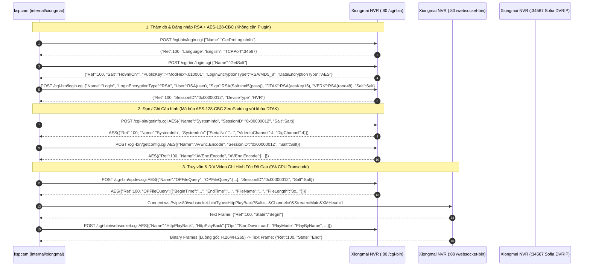

# Đặc Tả Giao Thức Xiongmai (XM / iCSee / Sofia DVRIP 34567) & Phương Án Tích Hợp `ksp-camera-auto`

> **Tài liệu kỹ thuật trung tâm (Architecture, Reverse-Engineering Evidence & Protocol Specification)** phục vụ tích hợp dòng Đầu ghi hình DVR/HVR/NVR và Camera IP của hãng **Hangzhou Xiongmai Technology (XM / iCSee / XMeye /JFTech / Vantech-XM / Sofia)** vào hệ sinh thái `ksp-camera-auto` (`kspcam`), `go-shinobi-ksp`, và `redbida-go`.
>
> **Trạng thái hiện tại:** Đã hoàn tất khảo sát phần cứng thực tế trên node `inut_208_4` (`192.168.77.138`), tải trọn bộ cài đặt và Web SDK gốc, dịch ngược toàn diện bằng **REA MCP** và lập phương án kiến trúc (chưa sửa code trong `ksp-camera-auto`).

---

## 1. Danh Mục Đường Dẫn Thư Mục & Hiện Vật (Folder Paths & Artifacts Inventory)

Toàn bộ phần mềm, Web Bundle, thư viện DLL/EXE và tài liệu tham chiếu đã được lưu trữ đầy đủ trên máy chủ tại các đường dẫn tuyệt đối sau:

### 1.1 Thư mục Hiện vật Dịch ngược & SDK Gốc
| Đường dẫn tuyệt đối (Folder / File Path) | Dung lượng | Mô tả chi tiết nội dung |
| :--- | :---: | :--- |
| `/tmp/xm_re/` | `~208 MB` | Thư mục làm việc gốc chứa toàn bộ các gói tải về và giải nén phục vụ REA MCP. |
| `/tmp/xm_re/ocx/VideoPlayToolSetup.exe` | `44.9 MB` (`47,126,299 B`) | Bộ cài NSIS gốc tải từ `http://xmsecu.com:8080/ocx/VideoPlayToolSetup.exe` (redirect sang `https://ocx.jftechws.com/ocx/VideoPlayToolSetup.exe`).<br>**SHA-256:** `58d9e79cde1d663d539fa0c77ffa4a584cc653c042817f5c8fd8079505cd6853`. |
| `/tmp/xm_re/ocx_extracted/` | `162.2 MB` (`471 files`) | Toàn bộ cây thư mục giải nén từ `VideoPlayToolSetup.exe` bằng `7z`. |
| `/tmp/xm_re/ocx_extracted/Web/` | `~6.8 MB` | **Mã nguồn Web SPA đầy đủ** (do đầu ghi Flash 8MB bật cờ `g_b8M = !0` nên giao diện đầy đủ nằm trong gói này). |
| `/tmp/xm_re/ocx_extracted/Web/plugin/class.js` | `152.3 KB` (`4,244 dòng`) | **File quan trọng nhất:** Chứa lớp `CGIClass` (điều khiển trực tiếp qua HTTP `/cgi-bin/*.cgi` + WebSocket `/websocket-bin/*`), `BrowseCtrl`, `AlarmCenter`, và `DeviceInfo`. |
| `/tmp/xm_re/ocx_extracted/Web/plugin/common.js` | `29.1 KB` (`1,167 dòng`) | Định nghĩa toàn bộ bảng hằng số `WSMsgID` (`0..41`), `WEB_ERROR`, `devTypeEnum`, `g_recTypeEnum`, `Protocol_V2`. |
| `/tmp/xm_re/ocx_extracted/Web/plugin/function.js` | `113.6 KB` (`3,467 dòng`) | Chứa các hàm mã hóa `AesEncrypt`, `AesDecrypt` (`AES-128-CBC ZeroPadding`), `HexIpToDecIp`, `DecIpToHexIp`, `ExtractMask`, `GetRandomFunc`. |
| `/tmp/xm_re/ocx_extracted/Web/plugin/language.js` | `86.1 KB` (`1,682 dòng`) | Chứa hàm `getCodeErrorString(Ret)` ánh xạ toàn bộ mã lỗi `Ret` của thiết bị (`100..609`). |
| `/tmp/xm_re/ocx_extracted/Web/html/` | `~210 KB` | Các controller chính: `login.js`, `live.js`, `playback.js`, `config.js`, `alarm.js`, `timeline.js`, `forgetpwd.js`. |
| `/tmp/xm_re/ocx_extracted/Web/html/cfg/` | `~2.4 MB` (`150 files`) | **150 tệp `.js`/`.html` đặc tả từng bảng cấu hình:** `System_Encode.js`, `System_Display.js`, `System_Network.js`, `Advance_Remote.js`, `Advance_HddManager.js`, `Advance_Account.js`, `Advance_AutoMaintain.js`, `NetService_RTSP.js`, `Record_Manager.js`, ... |
| `/tmp/xm_re/ocx_extracted/Web/lg/Vietnamese.xml` | `116.5 KB` | Từ điển ngôn ngữ Tiếng Việt chính hãng của Xiongmai (cùng 32 ngôn ngữ khác). |
| `/tmp/xm_re/ocx_extracted/Bin/NetSdk.dll` | `824 KB` | Thư viện PE32+ (`x86_64`) xuất khẩu 220 hàm chuẩn `H264_DVR_*` (`H264_DVR_Login`, `H264_DVR_GetDevConfig_JsonV2`, `H264_DVR_FindFile`, ...).<br>**SHA-256:** `e7a5f52af5016a28af5d214b52aac2bb6236e4187428ab9bba173c353a4fe6d9`. |
| `/tmp/xm_re/ocx_extracted/Bin/XNetSDK.dll` | `29.0 MB` | Thư viện lõi C++ (`XSDK_LIB::CNetDevice`, `CProtocolNetIP`, `CChnRecord`, `CChnRealStream`) chứa giao thức TCP `34567` (`Handshake_Begin`, `DeviceOption`, `NewLoginPTL`). |
| `/tmp/xm_re/ocx_extracted/Bin/VideoPlugin_x64.exe` | `2.2 MB` | Dịch vụ cầu nối cục bộ (`127.0.0.1:54455/Cmd-WebLocalCtrl` & WebSocket `/VideoPlay`). |
| `/tmp/xm_re/web/` | `248 KB` | Các file bootstrap tải trực tiếp từ đầu ghi `192.168.77.138:80` (`http://a.inut.vn:37125/`): `index.html`, `pluginVersion.js`, `js/main.js`, `js/md5-min.js` (chứa hàm `MD5_8`), `js/rsa.js` (chứa `RSAKey` PKCS#1 v1.5), `js/jsbn.js`, `js/xmlhttp.js`. |

### 1.2 Thư mục Lưu trữ Bền vững & Dự án Liên quan
| Đường dẫn tuyệt đối (Folder Path) | Vai trò |
| :--- | :--- |
| `/home/ksp/restore-4-1/xm-sdk-reference/device-web-8m/` | Bản sao lưu bền vững toàn bộ Web Bootstrap tải trực tiếp từ đầu ghi `192.168.77.138`. |
| `/home/ksp/restore-4-1/xm-sdk-reference/ocx-web-full/` | Bản sao lưu bền vững toàn bộ thư mục `Web/` (`plugin/*.js`, `html/*.js`, `html/cfg/*.js`, `lg/*.xml`) trích xuất từ `VideoPlayToolSetup.exe`. |
| `/home/ksp/restore-4-1/` | Repo GitHub Private [`inut-team/ghi-chu-camera-nha-yen-hung`](https://github.com/inut-team/ghi-chu-camera-nha-yen-hung) lưu cấu hình Nhà Yến Anh Hùng Gò Vấp (`inut_208_4`). |
| `/home/ksp/ksp-camera-auto/` | Repo mã nguồn chính của `kspcam` (`:2028`), `inut-bida-agent`, `inut-bida-hub` — nơi sẽ triển khai package `internal/xiongmai` và `internal/camera/xiongmai.go`. |
| `/home/ksp/go-shinobi-ksp/` | Repo mã nguồn `go-shinobi-ksp` (`:8080`) liên thông với `kspcam` qua `PROTOCOL-NVR-BRIDGE.md`. |
| `/home/ksp/redbida-go/` | Repo mã nguồn `redbida-go` (`:2023`) phục vụ xem lại, CheckVAR, Slow-Mo và cắt clip MP4. |
| `/home/ksp/ksp-pdfsign/docs/PROTOCOL-XIONGMAI-DVRIP-KSPCAM.md` | Bản gốc của tài liệu đặc tả này được host trực tuyến trên `ksp-pdfsign`. |

---

## 2. Sổ Cái Bằng Chứng Dịch Ngược (REA MCP Evidence Ledger)

| Hạng mục kiểm chứng | Công cụ REA MCP / Thực nghiệm | Mã Bằng Chứng (Evidence ID / Digest) | Kết luận Kỹ thuật |
| :--- | :--- | :--- | :--- |
| **Cấu trúc PE & Tài nguyên bộ cài** | `mcp__rea_inspect_pe_resources` | `ev_1ce203f282f0495660fe05f7c0fe3335b5d40a15a2f2e497cd77fa983e76a5dc` | Xác thực PE32 Nullsoft Installer (`47,126,299 B`), 21 tài nguyên, chứa phân vùng nén LZMA:23 gồm `Web/` và `Bin/`. |
| **Đồ thị ngữ nghĩa ứng dụng JS** | `mcp__rea_analyze_javascript_application` | `ev_0c406fdd92245c93390fff338a0e98e5eadad5ecf1260ed993d11675f19f2e43`<br>(View: `ev_c235790028254db4759e825b0048f5a64a19258f5fee33e6a11be7e47c59ab9c`) | Phân tích 10,429 nút AST trên `common.js`, `login.js`, `config.js` (`SHA-256: 082044f8...`); trích xuất toàn bộ bảng hằng số `WSMsgID` và luồng gọi `gDevice.GetMsg` / `SendMsg`. |
| **Thư viện Native `NetSdk.dll`** | `mcp__rea_open_binary` + Export Table | `SHA-256: e7a5f52af5016a28af5d214b52aac2bb6236e4187428ab9bba173c353a4fe6d9` | PE32+ `x86_64`, xuất khẩu 220 hàm `H264_DVR_*` và `XSDK_*` (`XSDK_DevLoginSyn`, `XSDK_DevGetChnConfigSyn`, `XSDK_DevSnapSyn`, `XSDK_DevFindFileSyn`). |
| **Thư viện Lõi `XNetSDK.dll`** | Phân tích `.rdata` & `.text` (`ProtocolNetIP.cpp`, `NetDevice.cpp`) | VMA `0x180250f00` (`MsgId 1413`), `0x18028a480` (`DeviceOption` / `RSA` / `AES`) | Xác định cơ chế bắt tay mới trên cổng TCP `34567` (`Handshake_Begin` $\to$ `DeviceOption` $\to$ `LoginEncryptionType: RSA`, `DataEncryptionType: AES`). |
| **Thực nghiệm thiết bị sống (`192.168.77.138`)** | Probe trực tiếp qua `a.inut.vn:37124` (`34567/tcp`) & `a.inut.vn:37125` (`80/tcp`) | MAC `00:12:43:aa:de:9e` (Hangzhou Xiongmai Tech), `uc-httpd 1.0.0` | Thiết bị phản hồi `{"Ret":100, "Language":"English", "TCPPort":34567}` tại `/cgi-bin/login.cgi` và cấp `Salt` + `PublicKey` RSA 1024-bit tại `{"Name":"GetSalt"}`. |

---

## 3. Đặc Tả Chi Tiết Giao Thức Xiongmai (HTTP CGI + WebSocket & Sofia DVRIP 34567)

Thiết bị Xiongmai hỗ trợ **2 đường giao tiếp song song**:
1. **Đường HTTP CGI + WebSocket trên cổng `80/tcp`** (`CGIClass` trong `Web/plugin/class.js`): Hoàn toàn không cần plugin ActiveX/EXE, hỗ trợ đầy đủ đọc/ghi cấu hình JSON, tìm file ghi hình, tải file ghi hình tốc độ cao qua WebSocket nhị phân và chụp ảnh Snapshot.
2. **Đường TCP Nhị phân Sofia DVRIP trên cổng `34567/tcp`** (`XNetSDK.dll` / `NetSdk.dll`): Giao thức đóng gói khung 20-byte header + JSON payload.



---

### 3.1 Thuật Toán Băm Mật Khẩu `MD5_8` (Chuẩn Sofia / Xiongmai)

Trích xuất nguyên bản từ `/tmp/xm_re/web/js/md5-min.js`:
- Đầu vào: chuỗi mật khẩu gốc `password` (UTF-8).
- Bước 1: Tính mảng 16 byte `digest = MD5(password)`.
- Bước 2: Với mỗi chỉ số $i \in \{0, 1, \dots, 7\}$, cộng 2 byte liền kề rồi chia lấy dư cho `62`:
  $$r_i = (\text{digest}[2i] + \text{digest}[2i + 1]) \bmod 62$$
- Bước 3: Ánh xạ $r_i$ sang bảng chữ cái 62 ký tự (`0-9`, `A-Z`, `a-z`):
  - Nếu $0 \le r_i \le 9$: `chr(r_i + 48)` (`'0'..'9'`)
  - Nếu $10 \le r_i \le 35$: `chr(r_i + 55)` (`'A'..'Z'`)
  - Nếu $36 \le r_i \le 61$: `chr(r_i + 61)` (`'a'..'z'`)

**Cài đặt chuẩn trong Go (`internal/xiongmai/crypto.go`):**
```go
func MD5_8(input string) string {
	sum := md5.Sum([]byte(input))
	var out [8]byte
	for i := 0; i < 8; i++ {
		rem := (int(sum[2*i]) + int(sum[2*i+1])) % 62
		switch {
		case rem < 10:
			out[i] = byte('0' + rem)
		case rem < 36:
			out[i] = byte('A' + rem - 10)
		default:
			out[i] = byte('a' + rem - 36)
		}
	}
	return string(out[:])
}
```
*Ví dụ kiểm chứng:*
- `MD5_8("")` = `"tlJwpbo6"`
- `MD5_8("admin")` = `"6QNMIQGe"`
- `MD5_8("123456")` = `"nTBCS19C"`

---

### 3.2 Quy Trình Đăng Nhập RSA + AES-128-CBC Trên `/cgi-bin/login.cgi`

Trích xuất từ `CGIClass.prototype.CgiLogin` (`Web/plugin/class.js:272-328`) và `AesEncrypt`/`AesDecrypt` (`Web/plugin/function.js:2746-2786`):

1. **Lấy `Salt` và khóa công khai `PublicKey`**:
   - Request:
     ```http
     POST /cgi-bin/login.cgi?randnum=0.123456 HTTP/1.1
     Content-Type: application/json;charset=utf-8

     {"Name":"GetSalt"}
     ```
   - Response từ thiết bị `192.168.77.138`:
     ```json
     {
       "Ret": 100,
       "Salt": "Ho9mICnr",
       "PublicKey": "B12F6E94DBC28BBB018BFDF6AF5CB432388539B2F1D3F7B38100C8E4F69C65C7E3379A748A7D9365F67CB426D8B36156C922A3EF50E012AF4543C23802DC42CEE4C77683B1F7656A73F8577ABCD0E0A7CE740CD19E6A9928734F6B142ED976AA05D5B466F131EA7363928E9EC09110A4EAEDE4A5DF7760F91D120691A8BCF797,010001",
       "LoginEncryptionType": "RSA/MD5_8",
       "DataEncryptionType": "AES"
     }
     ```
2. **Đóng gói bản tin `Login`**:
   - Tách `PublicKey` theo dấu `,`: phần tử `0` là Modulus $N$ (1024-bit hex), phần tử `1` là Exponent $E = \text{0x010001} = 65537$.
   - Nếu `LoginEncryptionType` chứa `"RSA"`:
     - `pwMD5 = hex_md5(password)` (32 ký tự hex chữ thường; lưu ý: khác với `MD5_8`, nhánh RSA nối `Salt` với `hex_md5(password)` 32 ký tự!).
     - `Sign = RSA_Encrypt_PKCS1v15_Hex(oemHeader + Salt + pwMD5)` (với `oemHeader = ""` mặc định, hoặc `"GIGA_"` nếu OEM là GIGA).
     - `User = RSA_Encrypt_PKCS1v15_Hex(username)`
     - `VERK = RSA_Encrypt_PKCS1v15_Hex(randomHex96Chars)` (48 bytes ngẫu nhiên mã hóa thành chuỗi 96 ký tự hex chữ thường trước khi đưa vào RSA).
     - Nếu `DataEncryptionType == "AES"`:
       - Sinh khóa `aesKey` gồm 16 ký tự ASCII ngẫu nhiên trong dải `chr(48..90)` (`'0'..'Z'`).
       - `DTAK = RSA_Encrypt_PKCS1v15_Hex(aesKey)`
     - Gửi POST `/cgi-bin/login.cgi` (bản tin `Login` gửi dưới dạng JSON thuần, **chưa** bật AES):
       ```json
       {
         "Name": "Login",
         "LoginEncryptionType": "RSA",
         "VERK": "<hex_rsa_cipher>",
         "DTAK": "<hex_rsa_cipher>",
         "User": "<hex_rsa_cipher>",
         "Sign": "<hex_rsa_cipher>",
         "Salt": "Ho9mICnr"
       }
       ```
   - Nếu thiết bị đời cũ chỉ hỗ trợ `"MD5_8"`:
     - `Sign = MD5_8(Salt + oemHeader + MD5_8(password))`
     - Gửi `{"Name": "Login", "LoginEncryptionType": "MD5_8", "User": username, "Sign": Sign, "Salt": Salt}`.
3. **Mã hóa / Giải mã Payload sau khi Login (`DataEncryptionType == "AES"`)**:
   - Thuật toán: **`AES-128-CBC`**
   - Khóa `key`: 16 bytes UTF-8 của `aesKey` (đã gửi trong `DTAK`).
   - Vector khởi tạo `iv`: `CryptoJS.enc.Utf8.parse("")` $\to$ **16 bytes `0x00`** (`make([]byte, 16)`).
   - Padding: **`ZeroPadding`** (đệm byte `0x00` vào cuối chuỗi UTF-8 cho chẵn bội số 16 bytes; nếu độ dài vốn đã chia hết cho 16 thì không đệm hoặc đệm theo chuẩn CryptoJS ZeroPadding).
   - Định dạng truyền tải: Chuỗi **Base64** (`Content-Type: text/plain;charset=utf-8`).
   - *Gotcha quan trọng từ `class.js:223`*: Đối với một số phản hồi JSON quá dài (ví dụ lấy cấu hình `Record` của 64 kênh), thiết bị có thể trả về chuỗi JSON trần không mã hóa AES. Do đó khi nhận phản hồi, kiểm tra nếu chuỗi bắt đầu bằng `{` và `json.Unmarshal` hợp lệ có trường `"Name"` thì dùng luôn, ngược lại mới giải mã Base64 + `AES-128-CBC` rồi `strings.TrimRight(plain, "\x00\r\n")`.
4. **Giữ sống phiên (`KeepAlive`)**:
   - Mỗi `10 giây` (hoặc khi dùng connection pool), gửi tới `/cgi-bin/login.cgi`:
     `{"Name": "KeepAlive", "Salt": Salt}` (mã hóa AES nếu phiên bật AES).

---

### 3.3 Giao Thức Nhị Phân Sofia DVRIP Trên Cổng TCP `34567`

Dành cho các tác vụ tốc độ cao hoặc khi cổng HTTP 80 bị đổi:
- **Khung Header 20 Bytes (Little-Endian)**:
  ```
  Offset  Size    Field           Giá trị / Mô tả
  0       1       HeadFlag        0xFF (Luôn bằng 0xFF)
  1       1       Version         0x01 (Sofia Protocol v1)
  2       1       Reserved1       0x00
  3       1       Reserved2       0x00
  4       4 (LE)  SessionID       uint32 (0 khi chưa login, sau login dùng SessionID thiết bị cấp)
  8       4 (LE)  SequenceNumber  uint32 (Tăng dần theo từng gói)
  12      1       TotalPacket     uint8  (0 nếu gói đơn; >1 nếu phân mảnh)
  13      1       CurPacket       uint8  (Chỉ số mảnh hiện tại)
  14      2 (LE)  MessageID       uint16 (Mã lệnh DVRIP, ví dụ 1000 = Login, 1020 = SystemInfo)
  16      4 (LE)  DataLength      uint32 (Độ dài phần body đi kèm)
  ```
- **Phần Body**: Chuỗi JSON kết thúc bằng `\n\x00` (2 bytes `0x0A 0x00`).
- **Bảng MessageID cốt lõi trên cổng `34567`**:
  | MessageID (Dec / Hex) | Tên Lệnh | Chiều | Ý nghĩa |
  | :---: | :--- | :---: | :--- |
  | `1000` (`0x03E8`) / `1001` | `LOGIN_REQ` / `RSP` | C $\leftrightarrow$ S | Đăng nhập phiên DVRIP |
  | `1002` (`0x03EA`) / `1003` | `LOGOUT_REQ` / `RSP` | C $\leftrightarrow$ S | Đăng xuất phiên |
  | `1006` (`0x03EE`) / `1007` | `KEEPALIVE_REQ` / `RSP` | C $\leftrightarrow$ S | Giữ kết nối |
  | `1020` (`0x03FC`) / `1021` | `SYSINFO_REQ` / `RSP` | C $\leftrightarrow$ S | Đọc `SystemInfo`, `StorageInfo`, `WorkState` |
  | `1040` (`0x0410`) / `1041` | `CONFIG_SET` / `RSP` | C $\leftrightarrow$ S | Ghi cấu hình (`AVEnc.Encode`, `NetWork.NetCommon`, ...) |
  | `1042` (`0x0412`) / `1043` | `CONFIG_GET` / `RSP` | C $\leftrightarrow$ S | Đọc cấu hình |
  | `1044` (`0x0414`) / `1045` | `DEFAULT_CONFIG_GET` | C $\leftrightarrow$ S | Đọc cấu hình mặc định |
  | `1046` (`0x0416`) / `1047` | `CHANNEL_TILE_SET` | C $\leftrightarrow$ S | Đặt tên kênh (`ChannelTitle`) |
  | `1048` (`0x0418`) / `1049` | `CHANNEL_TILE_GET` | C $\leftrightarrow$ S | Đọc tên kênh (`ChannelTitle`) |
  | `1360` (`0x0550`) / `1361` | `ABILITY_GET` / `RSP` | C $\leftrightarrow$ S | Đọc `SystemFunction`, `EncodeCapability` |
  | `1400` (`0x0578`) / `1401` | `PTZ_REQ` / `RSP` | C $\leftrightarrow$ S | Điều khiển PTZ (`OPPTZControl`) |
  | `1412` (`0x0584`) / `1413` | `MONITOR_REQ` / `CLAIM` | C $\leftrightarrow$ S | Mở kênh xem trực tiếp (`OPMonitor`) |
  | `1420` (`0x058C`) / `1421` | `PLAYBACK_REQ` / `CLAIM` | C $\leftrightarrow$ S | Tải / Phát lại video ghi hình (`OPPlayBack`) |
  | `1440` (`0x05A0`) / `1441` | `FILEQUERY_REQ` / `RSP` | C $\leftrightarrow$ S | Tìm kiếm danh sách phân đoạn ghi hình (`OPFileQuery`) |
  | `1450` (`0x05AA`) / `1451` | `SYSMANAGER_REQ` / `RSP` | C $\leftrightarrow$ S | Reboot (`OPMachine`), HDD (`OPStorageManager`), Giờ (`OPTimeSetting`) |
  | `1452` (`0x05AC`) / `1453` | `TIMEQUERY_REQ` / `RSP` | C $\leftrightarrow$ S | Đọc/Đặt giờ thiết bị (`OPTimeQuery` / `OPUTCTimeSetting`) |
  | `1482` (`0x05CA`) / `1483` | `MODIFY_PSW_REQ` / `RSP` | C $\leftrightarrow$ S | Đổi mật khẩu tài khoản |

---

### 3.4 Bảng Mã Trạng Thái & Lỗi `Ret` (`Web/plugin/language.js:1632`)

| Mã `Ret` | Hằng số trong SDK | Ý nghĩa thực tế & Cách xử lý trong `kspcam` |
| :---: | :--- | :--- |
| **`100`** | `ERR_SUCESS` | Thành công. |
| **`603`** | `RET_NEED_REBOOT` | Lưu cấu hình thành công nhưng cần khởi động lại thiết bị để có hiệu lực. |
| `102` | `IDS_INFO_NO_SUPPORT` | Thiết bị / firmware không hỗ trợ tính năng hoặc bảng cấu hình này. |
| `103` | `IDS_INVALID_REQ` | Yêu cầu không hợp lệ (sai tên lệnh hoặc sai tham số). |
| `105` | `IDS_NO_LOGIN` | Phiên đăng nhập hết hạn $\to$ Tự động gọi lại `CgiLogin` và retry 1 lần. |
| `106` / `203` | `IDS_PSWERROR` | Sai tên đăng nhập hoặc mật khẩu. |
| `107` | `IDS_NO_POWER` | Tài khoản không đủ quyền quản trị. |
| `109` / `119` | `IDS_NO_FINDFILE` | Không có bản ghi hình nào trong khoảng thời gian truy vấn (`FindRecordings` trả mảng rỗng `[]`, không báo lỗi). |
| `117` | `IDS_JSON_ERROR` | Lỗi cú pháp JSON. |
| `124` | `IDS_ENCRYPT_ERROR` | Lỗi giải mã RSA / AES. |
| `136` | `IDS_CGI_ERROR_FORMAT` | Sai định dạng CGI hoặc `Salt` đã hết hạn / đã bị dùng bởi request khác. |
| `205` | `ERR_RSA_REQUIRED` | Cổng TCP `34567` từ chối đăng nhập `MD5_8` trần, yêu cầu bắt tay RSA/AES hoặc đăng nhập qua `/cgi-bin/login.cgi`. |
| `206` | `IDS_NAME_BLOCKED` | Tài khoản hoặc IP tạm thời bị khóa do thử sai mật khẩu quá số lần cho phép (~5 lần). |
| `207` | `IDS_IPBANNED` | Địa chỉ IP bị chặn trong `NetWork.IPFilter`. |
| `515` | `UPGRADE_FINISH` | Hoàn tất nâng cấp firmware. |
| `609` | `IDS_CONFIG_NOT_EXIST` | Bảng cấu hình không tồn tại trên thiết bị này. |

---

## 4. Danh Mục Điểm Cuối `/cgi-bin/*.cgi` & Cấu Trúc JSON Từng Nghiệp Vụ

Trong `CGIClass` (`Web/plugin/class.js:363-449`), mọi lệnh `gDevice.GetMsg(id, name)` và `gDevice.SendMsg(id, obj)` đều được ánh xạ tới `POST /cgi-bin/<cmd>.cgi`:

| Endpoint CGI | Các mã `WSMsgID` ánh xạ vào | Chức năng |
| :--- | :--- | :--- |
| `/cgi-bin/login.cgi` | `GetPreLoginInfo`, `GetSalt`, `Login`, `KeepAlive`, `Logout` | Quản lý phiên đăng nhập và khóa phiên AES. |
| `/cgi-bin/getability.cgi` | `WsMsgID_ABILITY_GET (0)`, `WSMsgID_GET_INTELL_ABILITY (24)` | Đọc năng lực toàn cục của thiết bị (`SystemFunction`, `EncodeCapability`). |
| `/cgi-bin/getchannelability.cgi` | `WSMsgID_CHANNEL_ABILITY_GET_REQ (7)` | Đọc năng lực của từng kênh IP con (`bypass@EncodeCapability.[0]`). |
| `/cgi-bin/getinfo.cgi` | `WsMsgID_SYSINFO_REQ (1)`, `WSMsgID_NET_LOCALSEARCH_REQ (6)` | Đọc `SystemInfo`, `StorageInfo`, quét camera LAN từ đầu ghi (`NetLocalSearch`). |
| `/cgi-bin/getconfig.cgi` | `WsMsgID_CONFIG_GET (3)`, `WsMsgID_CONFIG_CHANNELTILE_GET (2)` | Đọc mọi bảng cấu hình (`AVEnc.Encode`, `ChannelTitle`, `fVideo.OSDInfo`, `NetWork.*`). |
| `/cgi-bin/setconfig.cgi` | `WsMsgID_CONFIG_SET (5)`, `WsMsgID_CONFIG_CHANNELTILE_SET (4)` | Ghi mọi bảng cấu hình. |
| `/cgi-bin/getdefault.cgi` | `WsMsgID_DEFAULTCONFIG_GET (41)` | Đọc cấu hình mặc định. |
| `/cgi-bin/opdev.cgi` | `WSMsgID_SYSMANAGER_REQ (11)`, `WSMsgID_DSIKMANAGER_REQ (12)`, `WSMsgID_TIMEQUERY_REQ (13)`, `OPFileQuery` | Tìm kiếm video ghi hình (`OPFileQuery`), đồng bộ giờ (`OPUTCTimeSetting`), quản lý ổ cứng (`OPStorageManager`), khởi động lại (`OPMachine`). |
| `/cgi-bin/opptz.cgi` | `PTZcontrol` | Điều khiển quay quét PTZ (`OPPTZControl`). |
| `/cgi-bin/opcontrol.cgi` | `WSMsgID_SET_DIG_IP_REQ (27)`, `WSMsgID_SET_IPC_REBOOT_REQ (38)` | Đổi IP camera con từ NVR (`OPDIGSetIP`), khởi động lại camera con. |
| `/cgi-bin/usermanager.cgi` | `WSMsgID_USERS_GET (15)` .. `WSMsgID_MODIFYPASSWORD_REQ (23)` | Quản lý người dùng, nhóm quyền và đổi mật khẩu. |
| `/cgi-bin/websocket.cgi` | Điều khiển luồng WebSocket | Bắt đầu/Dừng tải file ghi hình (`HttpPlayBack` $\to$ `StartDownLoad`) hoặc dừng luồng cảnh báo (`Alarm`). |

---

### 4.1 Đọc Thông Tin Hệ Thống & Phân Loại Kênh Analog / IP (`SystemInfo`)

- **Request** (`POST /cgi-bin/getinfo.cgi`):
  ```json
  {"Name": "SystemInfo", "SessionID": "0x00000012", "Salt": "Ho9mICnr"}
  ```
- **Response**:
  ```json
  {
    "Name": "SystemInfo",
    "Ret": 100,
    "SystemInfo": {
      "SerialNo": "0123456789abcdef",
      "SoftWareVersion": "V4.03.R11.C6380102.12201.140000.0000000",
      "BuildTime": "2025-06-15 14:20:00",
      "Hardware": "XM530_80X50",
      "VideoInChannel": 0,
      "DigChannel": 8,
      "AudioInChannel": 8,
      "AlarmInChannel": 0,
      "AlarmOutChannel": 0,
      "TalkInChannel": 1,
      "UpdataTime": "2026-11-08 21:00:00"
    }
  }
  ```
- **Quy tắc tính số kênh (`class.js:1590`)**:
  - Tổng số kênh: `ChannelNum = VideoInChannel + DigChannel`.
  - Nếu chỉ số kênh 0-based `ch < VideoInChannel`: đây là **kênh Analog / Coaxial** (hoặc kênh nội tại của IPC khi `devType == DEV_IPC`). Cấu hình nằm trực tiếp tại `AVEnc.Encode[ch]`.
  - Nếu `ch >= VideoInChannel` (trên đầu ghi HVR / NVR): đây là **kênh IP kỹ thuật số** với chỉ số `nDig = ch - VideoInChannel`. Khi đọc/ghi cấu hình encode hoặc OSD của camera IP con gắn vào kênh này, Xiongmai sử dụng tiền tố xuyên kênh **`bypass@`**:
    - Đọc năng lực encode kênh IP: `{"Name": "bypass@EncodeCapability.[<nDig>]"}` tới `/cgi-bin/getchannelability.cgi`.
    - Đọc/Ghi cấu hình encode kênh IP: `{"Name": "bypass@AVEnc.Encode.[<nDig>]"}` tới `/cgi-bin/getconfig.cgi` / `setconfig.cgi`.

---

### 4.2 Cấu Hình Luồng Video & Âm Thanh (`AVEnc.Encode` & `AVEnc.SmartH264`)

Trích xuất từ `/tmp/xm_re/ocx_extracted/Web/html/cfg/System_Encode.js`:
- **Đọc cấu hình**: `POST /cgi-bin/getconfig.cgi` với `{"Name": "AVEnc.Encode"}` (hoặc `{"Name": "bypass@AVEnc.Encode.[<nDig>]"}`).
- **Cấu trúc phần tử `AVEnc.Encode[ch]`**:
  ```json
  {
    "MainFormat": {
      "AudioEnable": true,
      "VideoEnable": true,
      "Audio": {
        "Bitrate": 64,
        "Compression": "G711_ALAW",
        "Depth": 16,
        "Frequency": 8000,
        "Mode": 0
      },
      "Video": {
        "BitRate": 2048,
        "BitRateControl": "CBR",
        "Compression": "H.265",
        "FPS": 25,
        "GOP": 2,
        "Quality": 4,
        "Resolution": "1080P"
      }
    },
    "ExtraFormat": {
      "AudioEnable": true,
      "VideoEnable": true,
      "Video": {
        "BitRate": 512,
        "BitRateControl": "VBR",
        "Compression": "H.265",
        "FPS": 25,
        "GOP": 2,
        "Quality": 3,
        "Resolution": "D1"
      }
    }
  }
  ```
- **Bảng ánh xạ tên Độ phân giải (`res_type` trong `System_Encode.js:130-145`)**:
  | Mã `Resolution` Xiongmai | Kích thước Pixel (`Width x Height` PAL/NTSC) |
  | :---: | :---: |
  | `"4K"` | `3840 x 2160` |
  | `"12M"` | `4000 x 3000` |
  | `"8M"` | `3264 x 2448` |
  | `"6M"` | `3072 x 2048` |
  | `"5M"` | `2560 x 1920` |
  | `"4M"` | `2560 x 1440` (2K QHD) |
  | `"3M"` | `2048 x 1536` |
  | `"2_5M"` | `1872 x 1408` |
  | `"WUXGA"` | `1920 x 1200` |
  | `"1080P"` | `1920 x 1080` (Full HD) |
  | `"UXGA"` | `1600 x 1200` |
  | `"1_3M"` | `1280 x 960` |
  | `"720P"` | `1280 x 720` (HD) |
  | `"1080N"` | `944 x 1080` |
  | `"WSVGA"` | `1024 x 576` |
  | `"650TVL"` | `928 x 576` |
  | `"D1"` | `704 x 576` |
  | `"VGA"` | `640 x 480` |
  | `"NHD"` | `640 x 360` |
  | `"BCIF"` / `"HD1"` | `352 x 576` / `704 x 288` |
  | `"CIF"` | `352 x 288` |
  | `"QVGA"` | `320 x 240` |
  | `"QCIF"` | `176 x 144` |
- **Lưu ý đặc thù về `GOP` của Xiongmai**:
  - Khác với Dahua/Hikvision lưu `GOP` theo **số khung hình (frames)** (ví dụ `50` frames), Xiongmai lưu `Video.GOP` theo **số giây (seconds)** trong khoảng `1..12` giây (thường là `2` giây)!
  - Khi đọc lên `kspcam` (`Probe`): nếu `Video.GOP <= 15`, quy đổi sang số khung hình `GOP_frames = Video.GOP * Video.FPS` (hoặc giữ nguyên và khi `Apply` từ `kspcam` truyền xuống `gop = 50` frames thì chia `gopSec = clamp(round(gop / fps), 1, 12)`).
- **SmartCodec (`AVEnc.SmartH264` / `AVEnc.SmartH264V2`)**:
  - Đọc/Ghi bảng `{"Name": "AVEnc.SmartH264"}` (mảng theo kênh `[{"SmartH264": true}]`) hoặc `{"Name": "AVEnc.SmartH264V2"}` (`{"SmartH264Plus": 1}`).

---

### 4.3 Tên Kênh & OSD Nhiều Dòng (`ChannelTitle`, `fVideo.VideoWidget`, `fVideo.OSDInfo`)

Trích xuất từ `/tmp/xm_re/ocx_extracted/Web/html/cfg/System_Display.js`:
1. **Tên kênh (`ChannelTitle`)**:
   - Đọc (`POST /cgi-bin/getconfig.cgi`): `{"Name": "ChannelTitle"}` $\to$ trả về mảng chuỗi tên các kênh `{"Name": "ChannelTitle", "ChannelTitle": ["Cam 01", "Cam 02", ...], "Ret": 100}`.
   - Ghi (`POST /cgi-bin/setconfig.cgi`): `{"Name": "ChannelTitle", "ChannelTitle": ["Tên mới 1", ...]}` (giới hạn 64 bytes UTF-8 mỗi kênh).
2. **Dòng chữ OSD tùy chỉnh (`fVideo.OSDInfo`)**:
   - Đọc/Ghi bảng `{"Name": "fVideo.OSDInfo"}`: Hỗ trợ tối đa `nOSDNum = 4` dòng chữ OSD (`OSDInfo[ch].OSDInfoWidget[0..3]`), khớp hoàn toàn với 4 dòng `OSDLines` của `kspcam`!

---

### 4.4 Danh Sách Camera IP Con Trên Đầu Ghi (`NetWork.RemoteDeviceV3` & `NetWork.ChnStatus`)

Trích xuất từ `/tmp/xm_re/ocx_extracted/Web/html/cfg/Advance_Remote.js` và `Advance_Digital.js`:
- Đọc bảng `{"Name": "NetWork.RemoteDeviceV3"}` và `{"Name": "NetWork.ChnStatus"}`:
  - Mỗi phần tử `NetWork.RemoteDeviceV3[nDig]` chứa:
    - `Enable`: `true` / `false`
    - `SingleConnId`: chỉ số kết nối đang dùng (`1`-based)
    - `ConnType`: `"SINGLE"` hoặc `"MULTI"`
    - `Decoder`: mảng cấu hình kết nối tới camera IP con, gồm:
      - `IPAddress`: địa chỉ IP LAN của camera con (ví dụ `"192.168.77.34"`)
      - `Port`: cổng kết nối (`34567`, `80`, `554`, `37777`, `8000`)
      - `Protocol`: `"TCP"` (Xiongmai NetIP), `"ONVIF"`, `"RTSP"`, `"DAHUA"`, `"NAT"`
      - `UserName`: tài khoản camera con
      - `Channel`: kênh trên thiết bị con

---

### 4.5 Cấu Hình Mạng & Quy Tắc Mã Hóa IP Hex Little-Endian (`NetWork.NetCommon`)

Trích xuất từ `/tmp/xm_re/ocx_extracted/Web/plugin/function.js:69-92` và `System_Network.js`:
- Bảng `{"Name": "NetWork.NetCommon"}`:
  ```json
  {
    "Name": "NetWork.NetCommon",
    "NetWork.NetCommon": {
      "HostIP": "0x8A4DA8C0",
      "Submask": "0x00FFFFFF",
      "GateWay": "0x014DA8C0",
      "HttpPort": 80,
      "TCPPort": 34567,
      "UDPPort": 34568,
      "MAC": "00:12:43:aa:de:9e"
    }
  }
  ```
- **Quy tắc chuyển đổi IP của Xiongmai (`HexIpToDecIp` / `DecIpToHexIp`)**:
  - `"0x8A4DA8C0"`:
    - Byte thấp nhất `0xC0` = `192`
    - Byte thứ 2 `0xA8` = `168`
    - Byte thứ 3 `0x4D` = `77`
    - Byte cao nhất `0x8A` = `138`
    $\to$ **`192.168.77.138`**!

---

### 4.6 Tìm Kiếm & Tải Video Ghi Hình Tốc Độ Cao (`OPFileQuery` & `HttpPlayBack`)

Trích xuất từ `Web/plugin/class.js:2557-2983` và `Web/html/playback.js`:
1. **Truy vấn danh sách phân đoạn ghi hình (`FindRecordings`)**:
   - Gửi `POST /cgi-bin/opdev.cgi`:
     ```json
     {
       "Name": "OPFileQuery",
       "OPFileQuery": {
         "Channel": 0,
         "BeginTime": "2026-11-08 00:00:00",
         "EndTime": "2026-11-08 23:59:59",
         "Type": "h264",
         "Event": "*",
         "DriverTypeMask": "0x0000FFFF",
         "StreamType": "0x00000000"
       },
       "SessionID": "0x00000012",
       "Salt": "Ho9mICnr"
     }
     ```
   - Mỗi lần gọi trả về tối đa **64 phân đoạn** (`OPFileQuery[]`):
     ```json
     {
       "BeginTime": "2026-11-08 18:00:00",
       "EndTime": "2026-11-08 19:00:00",
       "FileName": "/idea0/2026-11-08/001/18.00.00-19.00.00[R][@0][0].h264",
       "FileLength": "0x00080000",
       "DiskNo": 0,
       "SerialNo": 0
     }
     ```
   - *Lưu ý*: `FileLength` tính theo đơn vị **Kilobytes (KB)** ở dạng chuỗi Hex (`"0x00080000"` KB = `524,288 KB` = `512 MB`). Nếu mảng trả về đủ `64` phần tử, tiếp tục gọi trang kế tiếp với `BeginTime = files[63].EndTime`.
2. **Tải luồng gốc tốc độ LAN (`0% CPU Encode` — `100% Stream Copy`)**:
   - **Cách 1 (WebSocket `HttpPlayBack` trên cổng 80)**:
     1. Mở kết nối WebSocket:
        `ws://<ip>:<httpPort>/websocket-bin/Type=HttpPlayBack?Salt=<Salt>&Channel=<ch>&Stream=Main&XMHead=1`
     2. Chờ frame text đầu tiên từ thiết bị: `{"Ret": 100, "State": "Begin"}`.
     3. Gửi `POST /cgi-bin/websocket.cgi`:
        ```json
        {
          "Name": "HttpPlayBack",
          "HttpPlayBack": {
            "Opr": "StartDownLoad",
            "PlayMode": "PlayByName",
            "Channel": 0,
            "Stream": "Main",
            "ExactSeek": 1,
            "PlayByName": {
              "LocalTime": "2026-11-08 18:05:00",
              "FileName": "/idea0/2026-11-08/001/18.00.00-19.00.00[R][@0][0].h264"
            }
          },
          "Salt": "Ho9mICnr"
        }
        ```
     4. Thiết bị bơm liên tục các frame nhị phân (`BinaryMessage`) chứa dữ liệu media gốc cho tới khi gửi frame text `{"Ret": 100, "State": "End"}` (hoặc đủ thời lượng `duration` cần cắt).
   - **Cách 2 (DVRIP `OPPlayBack` trên cổng TCP `34567`)**:
     - Gửi `MsgID = 1420` (`OPPlayBack` Action `"Claim"` $\to$ `"DownloadStart"` với `PlayByTime` hoặc `PlayByName`), nhận các gói media `MsgID = 1424` (`0x0590`) chứa khung nhị phân Xiongmai H264/H265.
   - **Đóng gói MP4 `+faststart` (`0% CPU`)**:
     - Đưa luồng elementary H.264/H.265 + G.711/AAC qua `ffmpeg -c:v copy -c:a copy -tag:v hvc1 -movflags +faststart` (tự động fallback `-c:v copy -an` nếu âm thanh G.711) vào `/dev/shm/kspcam-clips/<sha1>.mp4`.

---

## 5. Phương Án Kiến Trúc Tích Hợp Vào `ksp-camera-auto` (`kspcam`)

Khi bắt đầu triển khai code vào `/home/ksp/ksp-camera-auto`, kiến trúc được chia thành 4 module sạch, tuân thủ tuyệt đối chuẩn `CGO_ENABLED=0`:

### 5.1 Cây Thư Mục Sẽ Thêm Mới Trong `/home/ksp/ksp-camera-auto`
```
/home/ksp/ksp-camera-auto/
├── internal/
│   ├── config/
│   │   └── inventory.go          # Thêm VendorXiongmai = "xiongmai" (alias "xm", "icsee", "dvrip")
│   ├── xiongmai/                 # [MỚI] Package giao thức thuần Go cho Xiongmai
│   │   ├── crypto.go             # MD5_8, RSA PKCS#1 v1.5 Hex, AES-128-CBC ZeroPadding, HexIP<->DecIP
│   │   ├── client.go             # HTTP CGI (/cgi-bin/*.cgi) + Sofia DVRIP TCP (34567) dual-transport client
│   │   ├── system.go             # SystemInfo, StorageInfo, OPStorageManager, OPMachine (Reboot), OPTimeSetting, ModifyPassword
│   │   ├── encode.go             # AVEnc.Encode, bypass@AVEnc.Encode.[n], AVEnc.SmartH264, EncodeCapability
│   │   ├── osd.go                # ChannelTitle, fVideo.VideoWidget, fVideo.OSDInfo, NetWork.RemoteDeviceV3
│   │   ├── playback.go           # OPFileQuery, WebSocket HttpPlayBack & DVRIP OPPlayBack downloader
│   │   └── xiongmai_test.go      # Unit test & mock server kiểm thử toàn bộ giao thức
│   ├── camera/
│   │   ├── camera.go             # Nối case config.VendorXiongmai trong Open() & RTSPURL()
│   │   └── xiongmai.go           # [MỚI] Adapter xiongmaiCamera thực thi đầy đủ 12 interface của camera.go
│   ├── discovery/
│   │   └── nmap.go               # Quét thêm cổng 34567 + probe GetPreLoginInfo + nhận diện MAC 00:12:43 / 00:12:17
│   └── server/
│       └── bridge.go             # Thêm nhánh VendorXiongmai vào nvrBridge (FindRecordings + ExtractClip 0% CPU)
└── docs/
    └── PROTOCOL-XIONGMAI.md      # Tài liệu đặc tả giao thức trong repo ksp-camera-auto
```

### 5.2 Kế Hoạch Kiểm Thử (Verification Plan)
1. **Unit Tests (`go test ./internal/xiongmai/... ./internal/camera/...`)**:
   - Kiểm chứng vector `MD5_8` khớp 100% với `md5-min.js`.
   - Kiểm chứng `RSA_PKCS1v15` + `AES-128-CBC ZeroPadding` giải mã chính xác gói tin mẫu và xử lý trường hợp thiết bị trả về JSON lớn không mã hóa.
   - Kiểm chứng `HexIpToDecIp("0x8A4DA8C0") == "192.168.77.138"` và chiều ngược lại.
   - Kiểm chứng ánh xạ `bypass@AVEnc.Encode.[nDig]` cho đầu ghi HVR/NVR.
2. **Live Hardware Smoke Test trên `inut_208_4` (`192.168.77.138`)**:
   - Tự động dò tìm (`discovery`) nhận diện đúng đầu ghi `192.168.77.138` (`Vendor: xiongmai`, `TCPPort: 34567`, `HttpPort: 80`).
   - Khi có mật khẩu của đầu ghi `192.168.77.138`, kiểm thử `Probe`, `Snapshot`, `GetRemoteDevices`, và `FindRecordings` / `StreamPlaybackFast` qua `kspcam (:2028)`.

---

## 6. Hồ Sơ Xác Thực Thực Tế & Bảng Kênh Đã Giải Mã Trên `inut_208_4` (`192.168.77.138`)

### 6.1 Thông Tin Đầu Ghi & Tài Khoản Quản Trị Đã Kiểm Chứng (`Ret = 100` & `RTSP 200 OK`)
- **Model / Phần cứng:** `NBD80S16S-KL` (`16` kênh IP `DigChannel: 16`, `VideoInChannel: 0`)
- **Firmware:** `V4.03.R11.C6380233.12201.140000.0000000` (Build `2023-04-14 13:11:09`)
- **SerialNo:** `c1beba4793bccbdapnx9` (Khóa AES `GetRandomUser`: `a4793b1beba493bc` $\to$ giải mã `GetRandomUser.Info` ra `"p1:admin1 p2:101 t:1247"`)
- **Ổ cứng (`StorageInfo`):** `0x000E8E0D` ($\approx 953.8\text{ GB}$ / $1\text{ TB}$), ghi hình liên tục (`Status: 0`).
- **Danh sách tài khoản quản trị trên đầu ghi (Group `admin`, đủ 55 quyền + đồng bộ `System.ExUserMap` cho RTSP `:554`):**

| Vai trò | Username | Password | Băm `MD5_8` | Mã `System.ExUserMap` | Ghi chú |
|---|---|---|---|---|---|
| **Admin chính (`RandomUser`)** | `admin1` | `Inut12345` | `IgCDPz7Q` | `00111W51dDEyMzQS` | Tự động điền trên Web UI & tự động ánh xạ khi `kspcam` cấu hình `username: admin` |
| **Admin dự phòng (Backup)** | `admin2` | `Inut12345` | `IgCDPz7Q` | `00111W51dDEyMzQS` | Tài khoản dự phòng đồng bộ mật khẩu `Inut12345` (55 quyền + RTSP `:554`) |
| **Admin nội bộ / HDMI** | `pymid` | `pymid123` | `vg22TaVl` | `0011=cHltaWQxMjN` | Tài khoản `AutoLogin` trên màn hình HDMI cục bộ (`Memo: "admin 's account"`) |

> **Lưu ý kỹ thuật:** Firmware `V4.03.R11.C6380233` (`BuildTime >= 2022-12-28`) chặn cứng việc tạo hoặc đổi tên tài khoản thành `admin`, `root`, `system`, `guest`, `administrator` (`IDS_ACC_InvalidUserName`, trả `Ret: 101`). Để đồng bộ cấu hình mặc định `username: admin` của `kspcam`, `CGITransport` trong `internal/xiongmai` tự động gọi `/cgi-bin/resetpwd.cgi` (`GetDevInfo` + `GetRandomUser`) và ánh xạ `admin` $\to$ `admin1` ngay trước bước `Login`, đồng thời xử lý luôn lỗi dòng header có dấu cách đầu dòng (`" Content-type: text/plain\r\n"`) của `uc-httpd 1.0.0`.

### 6.2 Bảng 16 Kênh Camera IP Con Trích Xuất Từ `NetWork.RemoteDeviceV3` & `NetWork.ChnStatus`

| Kênh | Tên | Trạng thái | Độ phân giải | IP Camera con | Cổng / Giao thức | User | Password | Đường dẫn RTSP Main Stream |
|---|---|---|---|---|---|---|---|---|
| **CH01** | `D01` | `Connected` | `1080P/D1` | `192.168.77.71` | `554` / `RTSP` | `admin` | `pymid123` | `rtsp://192.168.77.71:554/0` |
| **CH02** | `D02` | `Offline` | `Unknown` | `192.168.77.218` | `554` / `RTSP` | `admin` | `pymid123` | `rtsp://192.168.77.218:554/Streaming/Channels/0` |
| **CH03** | `D03` | `Connected` | `1080P/704x576` | `192.168.77.34` | `554` / `RTSP` | `admin` | `tranhung1591984` | `rtsp://192.168.77.34:554/user=admin_password=tranhung1591984_channel=1_stream=0.sdp?real_stream` |
| **CH04** | `D04` | `Connected` | `1080P/720x576` | `192.168.77.146` | `554` / `RTSP` | `admin` | `admin` | `rtsp://192.168.77.146:554/0` |
| **CH05** | `D05` | `Connected` | `1080P/D1` | `192.168.77.178` | `554` / `RTSP` | `admin` | `admin` | `rtsp://192.168.77.178:554/0` |
| **CH06** | `D06` | `Connected` | `1080P/VGA` | `192.168.77.160` | `554` / `RTSP` | `admin` | `L2E8D64D` | `rtsp://192.168.77.160:554/cam/realmonitor?channel=1&subtype=0` |
| **CH07** | `D07` | `Connected` | `1080P/704x576` | `192.168.77.65` | `554` / `RTSP` | `admin` | `pymid123` | `rtsp://192.168.77.65:554/user=admin_password=pymid123_channel=1_stream=0.sdp?real_stream` |
| **CH08** | `D08` | `Connected` | `1080P/QVGA` | `192.168.77.205` | `554` / `RTSP` | `admin` | `tranhung159` | `rtsp://192.168.77.205:554/Streaming/Channels/101` |
| **CH09** | `D09` | `Connected` | `1080P/VGA` | `192.168.77.84` | `554` / `RTSP` | `admin` | `L21ACFE9` | `rtsp://192.168.77.84/cam/realmonitor?channel=1&subtype=0&unicast=true&proto=Onvif` |
| **CH10** | `D10` | `Connected` | `1080P/VGA` | `192.168.77.147` | `554` / `RTSP` | `admin` | `L2B74148` | `rtsp://192.168.77.147:554/cam/realmonitor?channel=1&subtype=0` |
| **CH11** | `D11` | `Offline` | `Unknown` | `192.168.77.98` | `554` / `RTSP` | `admin` | `tranhung159` | `rtsp://192.168.77.98:554/user=admin_password=tranhung159_channel=1_stream=0.sdp?real_stream` |
| **CH12–16** | `D12–16` | `NoConfig` | — | — | — | — | — | *(Chưa gán kênh)* |
